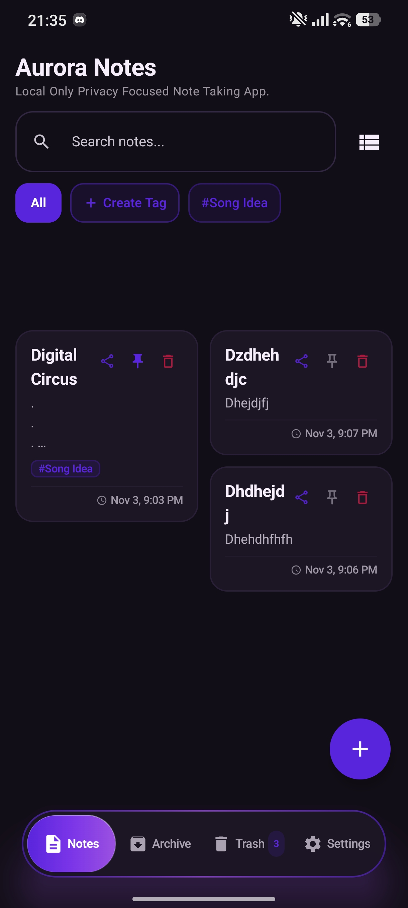
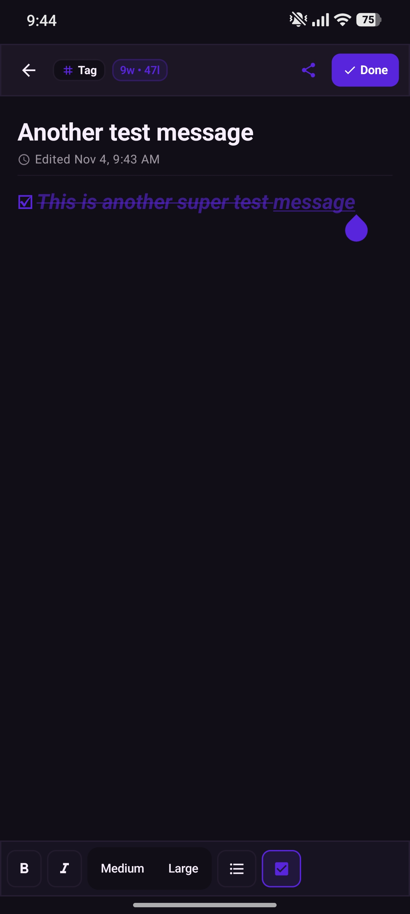
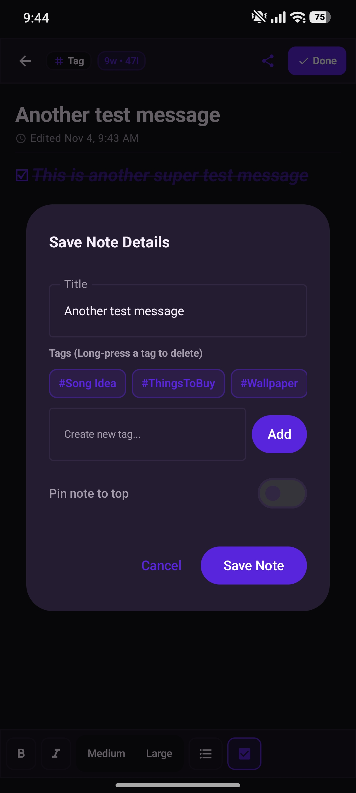
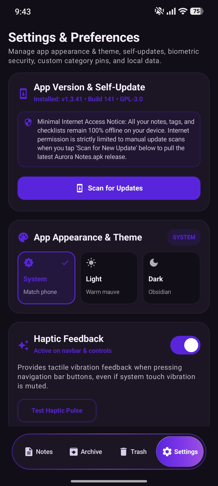
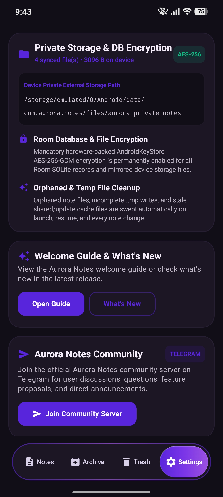
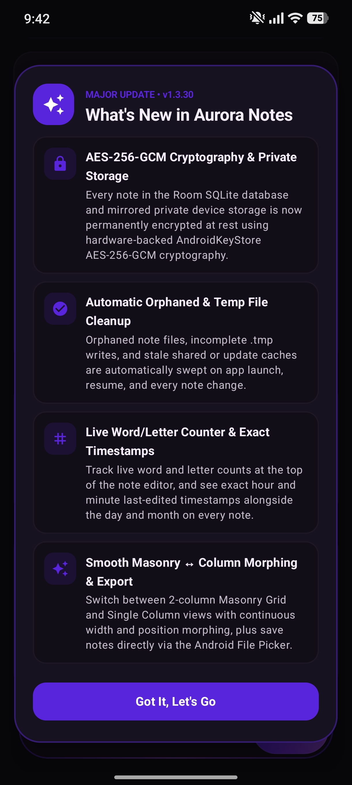
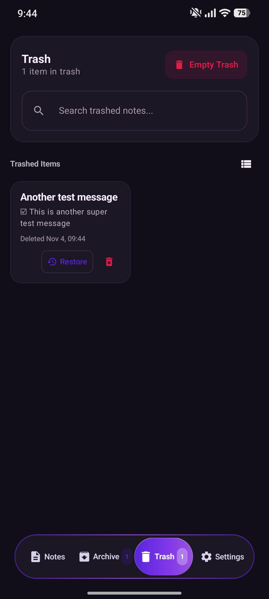

# Aurora Notes — Native Android (Jetpack Compose)

Aurora Notes is a privacy-first, local-only note-taking app built natively for Android using **Kotlin** and **Jetpack Compose**, protected by mandatory **hardware-backed AES-256-GCM cryptography**.

> ### Care, Maintenance, Cryptography & Privacy Notice
> **Aurora Notes** has been created with the help of **Argon 4 Gemini**. This app receives its deserved care and ongoing maintenance while strictly respecting the user's privacy — all notes, checklists, categories, and diagnostic logs stay 100% locally on your device with zero tracking or telemetry. Every note in the Room SQLite database and mirrored private device storage is permanently encrypted at rest using **AndroidKeyStore AES-256-GCM cryptography**.

---

## Visual Showcase & Screenshots

Experience Aurora Notes' tactile minimalism, fluid navigation, and deep focus interface:

| 📱 Home & Masonry Grid | ✍️ Note Editor & Checklists | 🏷️ Save Note & Categories |
| :---: | :---: | :---: |
|  |  |  |
| **Masonry Grid & Liquid Pill Navbar** | **Live Word Counter & Isolated Checklists** | **Custom Category Tags & Pin to Top** |

| ⚙️ Settings & Theme Customization | 🔒 Hardware-Backed AES-256 Storage | ✨ What's New & Release Highlights |
| :---: | :---: | :---: |
|  |  |  |
| **System, Light & Obsidian Dark Themes** | **Room DB & File-Level Encryption** | **In-App Version Changelog & Updates** |

| 🗑️ Local Trash & Safe Recovery |
| :---: |
|  |
| **Search Trashed Notes & One-Tap Restore** |

---

## Architecture & Features

1. **Mandatory AES-256-GCM Cryptography & Private Device Storage**:
   - **Hardware-Backed Encryption**: All Room SQLite database records and mirrored device storage files (`/Android/data/com.aurora.notes/files/aurora_private_notes`) are permanently encrypted at rest using AndroidKeyStore **AES-256-GCM** authenticated encryption (`ENCv1:` envelope with 96-bit IV + 128-bit GCM auth tag).
   - **Automatic Orphaned & Temp File Cleanup**: Automatically sweeps orphaned note files, incomplete `.tmp` atomic writes, and stale shared/update cache files on app launch, resume, and every note change.
   - **Biometric / System PIN Lock**: Optional native Android hardware biometric lock (Fingerprint, Face Unlock, or Device PIN) on launch and mandatory verification before wiping app data.

2. **Jetpack Compose UI & Smooth Layout Morphing**:
   - Modern declarative UI with a fluid horizontal pill navigation bar, tactile haptics, and continuous width + coordinate morphing between 2-column Masonry Grid and Single Column views.
   - Dual theme support (Light, Dark & System mode) with Royal Violet (`#5925DC`) accents.
   - Exact **Last Edited Timestamps** showing the month, day, hour, and minute (`MMM d, h:mm a`) on note cards and inside the note editor.

3. **100% Maximized Full-Screen Note Editor**:
   - Maximized editor window designed for mobile phones with **Auto-Save** on back navigation.
   - **Live Word & Letter Counter**: Real-time word and character counter pill (`w • l`) displayed in the top bar of the note editor.
   - **Clickable Purple Links**: URLs typed or pasted into notes automatically highlight in vibrant purple and open in the default Android browser when tapped.
   - **Sticky Mobile Keyboard Toolbar**:
     - Outline / bullet formatting.
     - 3 distinct text sizes (Small, Medium, Large).
     - Thick / Bold and Italic toggles.
     - Line-Isolated Checklist (`-1` prefix slot rule).

4. **Read-Only Archive Menu & Native File Picker Export**:
   - Press and hold one or multiple notes in the **Notes** menu to archive them in a single tap.
   - Archived notes are moved to the **Archive** menu and locked in **read-only mode** so their contents cannot be accidentally modified, while keeping **Restore** and **Delete** actions ready.
   - Share notes to apps & contacts or save `.md` / `.txt` files directly to any folder via the **Android Storage Access Framework (File Picker)**.

5. **Local Diagnostic Logs & Local Trash**:
   - Rolling 250-entry FIFO local diagnostics buffer restricted to warnings and errors in device memory.
   - Restoring, individual permanent shredding, and bulk Empty Trash with confirmation dialog and real-time search.

---

## Open Source License (GNU General Public License v3.0)

Under GitHub's terms and standard copyright law, a public repository without a license file defaults to *"All Rights Reserved"*, meaning it is not legally open source unless a license is explicitly declared.

To safeguard user freedom, prevent closed-source proprietary forks, and guarantee that Aurora Notes remains 100% free software forever, this project is licensed under the **[GNU General Public License v3.0 (GPL-3.0)](./LICENSE)**:

- **Strong Copyleft Protection**: Anyone is free to inspect, run, modify, and distribute Aurora Notes. However, any modified versions, forks, or derivative works distributed to others (including modified APKs or web distributions) **must also remain open source under the GPL-3.0** with corresponding source code made publicly available.
- **Privacy & Security Integrity**: Guarantees that no third party can strip out the offline-only, zero-telemetry, AES-256-GCM encryption architecture and turn it into a closed proprietary tracking or subscription service.
- **Explicit Patent Protection**: Protects contributors and end users through express patent grants against patent claims or patent troll litigation.
- **Anti-Tivoization**: Guarantees users the right and capability to run modified versions of the software on their own devices.

---

## Community & Discussion

Join the official **Aurora Notes Community** on Telegram to share feedback, ask questions, propose new features, and connect with other users:

👉 **[Join Aurora Notes Community Server (Telegram)](https://t.me/GithubAuroraNotes)**

